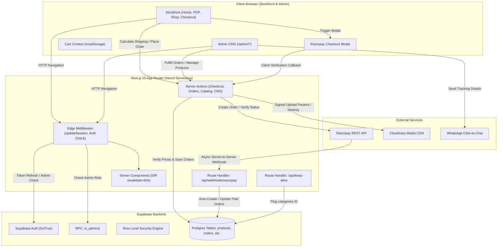

# AJVAS CHOCOLATES — COMPREHENSIVE PROJECT KNOWLEDGE BASE

---

## 1. Project Overview

**AJVAS CHOCOLATES** is an artisanal, luxury e-commerce application engineered for premium handcrafted chocolates, celebration gifting, and custom hampers with pan-India fulfillment. 

The application provides:
- A high-converting storefront featuring editorial storytelling, product discovery, customizable gift personalization, dynamic shipping calculation, and online payments.
- An operational Admin CMS portal for order triage, order fulfillment tracking, AWB assignments, automated WhatsApp customer notifications, batch A4 address slip generation, and catalog/content management.

Production Deployment: Deployed on **Vercel** connected to **Supabase** (PostgreSQL, Auth, Storage) and **Cloudinary** (Media CDN).

---

## 2. Technology Stack & Exact Versions

All versions confirmed directly from [package.json](file:///c:/Users/USER/OneDrive/Desktop/ajvas%20chocolates/package.json) and [package-lock.json](file:///c:/Users/USER/OneDrive/Desktop/ajvas%20chocolates/package-lock.json):

| Category | Technology | Exact Version | Description / Purpose |
| :--- | :--- | :--- | :--- |
| **Frontend Framework** | Next.js | `15.2.1` | App Router, Server Components, Server Actions, Route Handlers |
| **Core UI Library** | React / React DOM | `19.0.0` | React 19 concurrent features, transitions, hooks |
| **Programming Language** | TypeScript | `^5.8.2` | Full static type-safety across catalog, logistics, orders, and checkout |
| **CSS & Utility Framework** | Tailwind CSS | `^3.4.17` | Utility-first styling with custom brand color tokens and typography |
| **PostCSS / Autoprefixer**| PostCSS / Autoprefixer | `8.5.3` / `10.4.20` | CSS transformations and vendor prefixing |
| **Icons** | Lucide React | `^1.45.0` | SVG icons for storefront and admin operational interface |
| **Animation Engine** | Framer Motion | `^13.4.5` | Smooth page transitions and interactive micro-animations |
| **Styling Utilities** | `clsx` / `tailwind-merge` | `2.1.1` / `3.6.0` | Conditional class composition and deduplication |
| **Database & Auth Client**| `@supabase/supabase-js` | `^2.116.0` | PostgreSQL client & service-role database operations |
| **Supabase SSR Helpers** | `@supabase/ssr` | `^0.12.7` | Next.js App Router cookie-based session management |
| **Payment Gateway SDK** | Razorpay Node SDK | `^2.9.8` | Order generation, webhook verification, payment captures |
| **Media & CDN SDK** | Cloudinary Node SDK | `^2.11.0` | Signed asset uploads, version parsing, asset cleanup |
| **Code Linting** | ESLint / eslint-config-next| `9.21.0` / `15.2.1` | Static code analysis and Next.js lint rules |
| **Hosting Platform** | Vercel | Production | Serverless functions, Edge middleware, Automated daily Cron |
| **Runtime Environment** | Node.js | `>=20.0.0` (Tested `v22.15.0`) | JavaScript runtime |
| **Package Manager** | npm | `10.9.2` | Dependency management with lockfile integrity |

---

## 3. Project Directory Structure

```
ajvas-chocolates/
├── .env.example                          # Environment variable configuration template
├── .env.local                            # Local secret variables (git-ignored)
├── .gitignore                            # Standard Next.js/Node git ignore rules
├── AJVAS_DESIGN_MANIFEST.md              # Approved UI design system authority & Stitch mapping
├── CHANGELOG.md                          # Production engineering history and release logs
├── eslint.config.mjs                     # ESLint 9 configuration
├── next.config.ts                        # Next.js config (Cloudinary/Supabase remote image domains)
├── package.json                          # Manifest, dependencies, and build scripts
├── package-lock.json                     # Deterministic dependency lockfile
├── postcss.config.mjs                    # PostCSS pipeline configuration
├── tailwind.config.ts                    # Tailwind theme extensions, brand palette & tokens
├── tsconfig.json                         # TypeScript compiler configuration with path aliases (@/*)
├── vercel.json                           # Vercel deployment & daily keep-alive cron job schedule
├── database/
│   └── migrations/                       # Incremental additive SQL migrations
│       ├── 002_add_gift_customization.sql
│       ├── 003_gift_purpose_and_custom_fee.sql
│       └── 004_add_custom_gift_purpose_description.sql
├── public/                               # Static assets served at domain root
│   ├── about-image.jpeg                  # About Us editorial asset
│   ├── ajvaslogo-png.png                 # Official brand logo & wordmark
│   ├── bg-cover.png                      # Hero background banner graphic
│   └── trolly.png                        # Curated gift hamper illustration
├── scripts/                              # Automated standalone test verification scripts
│   ├── verify-admin-orders-date-grouping.mjs
│   ├── verify-admin-orders-workflow.mjs
│   ├── verify-compact-sticky-orders.mjs
│   ├── verify-custom-gift-purpose-description.mjs
│   ├── verify-gift-purpose-checkout-sync.mjs
│   ├── verify-gift-purpose.mjs
│   └── verify-slips.mjs
└── src/
    ├── instrumentation.ts                # Next.js startup initialization hook (Supabase keep-alive)
    ├── middleware.ts                     # Root Next.js Edge middleware routing
    ├── app/                              # Next.js App Router (Storefront, Admin, API)
    │   ├── layout.tsx                    # Root HTML layout, font injection (Inter & Cormorant Garamond)
    │   ├── page.tsx                      # Storefront Homepage with ISR (revalidate = 60s)
    │   ├── globals.css                   # Global styles, Tailwind base layers, A4 print media queries
    │   ├── sitemap.ts                    # Dynamic XML sitemap generator
    │   ├── robots.ts                     # Crawler instructions (protects /admin and /api)
    │   ├── error.tsx                     # Global error boundary UI
    │   ├── global-error.tsx              # Root HTML level error boundary
    │   ├── about/page.tsx                # Brand Story & Chocolatier philosophy page
    │   ├── care-instructions/page.tsx   # Storage & chocolate preservation guidelines
    │   ├── cart/                         # Cart routing (redirects to /checkout)
    │   │   ├── page.tsx
    │   │   └── loading.tsx
    │   ├── checkout/                     # Checkout module
    │   │   ├── actions.ts                # Server Actions (Shipping calculation, Razorpay order & verify)
    │   │   ├── layout.tsx
    │   │   ├── loading.tsx
    │   │   ├── page.tsx                  # Guest checkout page
    │   │   └── success/page.tsx          # Order confirmation, celebration confetti, reference copy
    │   ├── collections/page.tsx          # Curated collections & gift box showcases
    │   ├── contact/page.tsx              # Customer support & atelier inquiries
    │   ├── faq/page.tsx                  # Frequently asked questions
    │   ├── privacy-policy/page.tsx       # Storefront legal & data handling notice
    │   ├── refund-returns/page.tsx       # Perishable confection return policy
    │   ├── shipping-delivery/page.tsx    # Courier delivery times & regional rules
    │   ├── terms-conditions/page.tsx     # Terms of service
    │   ├── shop/                         # Shop catalog browse
    │   │   ├── page.tsx                  # All products list with category filter tabs
    │   │   ├── loading.tsx
    │   │   └── [slug]/page.tsx           # Category-specific filtered product listing
    │   ├── products/                     # Product Detail Page (PDP)
    │   │   └── [slug]/
    │   │       ├── page.tsx              # Dynamic PDP with JSON-LD, specs & gift customization
    │   │       ├── loading.tsx
    │   │       ├── not-found.tsx
    │   │       └── error.tsx
    │   ├── admin/                        # Protected Operational Admin Portal
    │   │   ├── layout.tsx                # Admin authentication verification wrapper
    │   │   ├── page.tsx                  # Triage operations dashboard & real-time metrics
    │   │   ├── login/page.tsx            # Admin authentication portal
    │   │   ├── categories/               # Category CRUD management
    │   │   │   ├── actions.ts
    │   │   │   └── page.tsx
    │   │   ├── couriers/                 # Courier partner tier management
    │   │   │   ├── actions.ts
    │   │   │   └── page.tsx
    │   │   ├── customers/page.tsx        # Guest customer directory & order history counts
    │   │   ├── gift-purposes/            # Standard gift occasions & custom fee config
    │   │   │   ├── actions.ts
    │   │   │   └── page.tsx
    │   │   ├── homepage/                 # Homepage CMS & Hero banner manager
    │   │   │   ├── actions.ts
    │   │   │   └── page.tsx
    │   │   ├── orders/                   # Order Management System
    │   │   │   ├── actions.ts            # Status transition & AWB tracking actions
    │   │   │   ├── page.tsx              # Order list with date grouping & IST filter
    │   │   │   ├── [id]/page.tsx         # Detailed order fulfillment view & timeline
    │   │   │   └── print/                # A4 Address Slip batch printing module
    │   │   │       ├── page.tsx
    │   │   │       └── PrintPageClient.tsx
    │   │   ├── pages/                    # Static pages CMS content manager
    │   │   │   ├── actions.ts
    │   │   │   └── page.tsx
    │   │   ├── products/                 # Product Catalog CMS
    │   │   │   ├── actions.ts            # Product CRUD, Cloudinary signatures & cleanup
    │   │   │   ├── page.tsx              # Product catalog table
    │   │   │   ├── new/page.tsx          # Product creation form
    │   │   │   └── [id]/page.tsx         # Product edit form
    │   │   ├── shipping-rates/           # Legacy shipping rate matrix
    │   │   │   ├── actions.ts
    │   │   │   └── page.tsx
    │   │   └── testimonials/             # Customer review CMS & decorative graphics
    │   │       ├── actions.ts
    │   │       └── page.tsx
    │   └── api/                          # Serverless Route Handlers
    │       ├── check-db/route.ts         # Disabled diagnostic endpoint (returns 404)
    │       ├── keep-alive/route.ts       # Supabase free-tier active connection ping
    │       ├── seed-pages/route.ts       # Disabled seed endpoint (returns 404)
    │       └── webhooks/
    │           └── razorpay/route.ts     # Razorpay webhook listener (payment.captured / order.paid)
    ├── components/                       # Reusable React Components
    │   ├── admin/                        # Admin Portal client components (tables, modals, forms)
    │   ├── cart/                         # Cart row and summary components
    │   ├── checkout/                     # Multi-step checkout components
    │   ├── home/                         # Editorial homepage sections
    │   ├── layout/                       # Header, Footer, Brand Logo, Announcement Bar
    │   ├── pdp/                          # Product gallery, pincode estimator, gift customizer
    │   ├── seo/                          # Structured JSON-LD schema injection
    │   ├── shop/                         # Shop collections client filter tabs
    │   └── ui/                           # Base UI primitives (Button, Badge, Container, ProductCard)
    ├── context/                          # React Client Contexts
    │   └── cart-context.tsx              # Global cart & buy-now state with localStorage sync
    ├── data/                             # Static datasets
    │   └── india-states-districts.ts     # Offline lookup of 36 Indian states & union territories
    ├── lib/                              # Core Utilities, Domain Logic & SDK Adapters
    │   ├── cloudinary/server.ts          # Server-only Cloudinary signed params & asset management
    │   ├── constants/testimonials.ts     # Seed testimonials
    │   ├── delivery-estimate.ts          # Delivery window calculation
    │   ├── gift-purpose-selection.ts     # Client gift purpose resolution
    │   ├── orders/
    │   │   ├── date-utils.ts             # Asia/Kolkata (IST) calendar day calculations
    │   │   ├── slip-utils.ts             # A4 address slip geometry & PIN code validation
    │   │   └── status-utils.ts           # Order status badge styling & transition rules
    │   ├── razorpay/                     # Razorpay client & server-only environment validation
    │   ├── seo.ts                        # SEO metadata constants, slugification, description truncation
    │   ├── supabase/                     # Supabase database clients, queries & auth helpers
    │   ├── utils/image-compression.ts    # Browser-side canvas image compression before upload
    │   ├── utils.ts                      # General cn() utility for Tailwind merging
    │   ├── validation/image-url.ts       # Image URL and Data URI safety validator
    │   └── whatsapp/order-message.ts     # WhatsApp order notification generator & deep links
    └── types/                            # Authoritative TypeScript Type Definitions
        ├── cart.ts
        ├── catalog.ts
        ├── checkout.ts
        ├── cms.ts
        ├── gift-purpose.ts
        ├── logistics.ts
        └── orders.ts
```

---

## 4. Application Architecture

### End-to-End Architectural Flow

The application is structured into four primary layers:
1. **Presentation & Storefront Layer**: Next.js 15 Server Components for SEO and fast First Contentful Paint (FCP), paired with Client Components for interactive forms, quantity steppers, cart state, and modal dialogues.
2. **Business Logic & Server Actions Layer**: Secure `"use server"` actions that perform server-side calculations, anti-tampering validation, Razorpay SDK calls, and session verification.
3. **Database & Authorization Layer**: Supabase PostgreSQL database governed by Row Level Security (RLS) policies and security-definer RPC functions (`public.is_admin()`).
4. **Third-Party Infrastructure**:
   - **Vercel**: Edge routing, serverless execution, automated daily Cron.
   - **Cloudinary**: Direct-to-CDN signed asset uploads and image transformations.
   - **Razorpay**: Hosted checkout, cryptographic HMAC SHA256 payment verification, asynchronous server-to-server webhooks.
   - **WhatsApp**: Direct click-to-chat operational messaging via deep links (`https://api.whatsapp.com/send`).



---

## 5. Database Schema & Supabase Architecture

The application communicates with a Supabase PostgreSQL instance via:
1. **Public Anonymous Client (`createClient` in `catalog.ts`)**: Reads active products and active categories conforming to public RLS policies.
2. **Server SSR Client (`createClient` in `server.ts`)**: Respects session cookies and checks `is_admin()` for protected admin operations.
3. **Service Role Client (`createServiceRoleClient` in `service-role.ts`)**: Uses the privileged `SUPABASE_SERVICE_ROLE_KEY` exclusively on the server to manage orders, insert webhook orders, and inspect logistics without exposing sensitive internal tables.

### Complete Table Inventory & Responsibilities

| Table Name | Primary Key | Key Columns | Relationships / Notes |
| :--- | :--- | :--- | :--- |
| `categories` | `id` (uuid) | `name`, `status`, `image_url`, `image_public_id`, `display_order` | One-to-Many with `products` |
| `products` | `id` (uuid) | `name`, `slug`, `price`, `discount_type`, `discount_value`, `status`, `availability`, `weight_grams`, `shipping_kerala`, `shipping_tn_kar`, `shipping_other` | Belongs to `categories`; Has many `product_images` |
| `product_images`| `id` (uuid) | `product_id`, `cloudinary_public_id`, `image_url`, `sort_order` | Many-to-One with `products` |
| `orders` | `id` (uuid) | `order_number`, `customer_name`, `customer_phone`, `customer_email`, `shipping_state`, `shipping_pincode`, `total_amount`, `subtotal`, `shipping_amount`, `gift_purpose`, `gift_purpose_fee`, `custom_gift_purpose_description`, `order_status`, `payment_status`, `razorpay_order_id`, `razorpay_payment_id`, `awb_number`, `tracking_url` | Has many `order_items` and `order_status_history` |
| `order_items` | `id` (uuid) | `order_id`, `product_id`, `product_name`, `product_slug`, `quantity`, `unit_price`, `line_total`, `customization` | Many-to-One with `orders` and `products` |
| `order_status_history`| `id` (uuid) | `order_id`, `status`, `note`, `changed_by`, `created_at` | Audit trail for order status transitions |
| `gift_purposes` | `id` (uuid) | `name` (unique), `is_active`, `sort_order` | Admin-managed standard occasions |
| `gift_purpose_settings`| `id` (int check id=1) | `custom_enabled`, `custom_fee` (numeric) | Singleton configuration row for custom occasion fee |
| `hero_banners` | `id` (uuid) | `title`, `description`, `image_url`, `status`, `display_order` | Homepage hero carousel items |
| `homepage_sections`| `id` (uuid)| `section_key` (unique), `title`, `content_json`, `status` | Configurable homepage CMS sections |
| `page_sections` | `id` (uuid) | `page`, `title`, `content`, `sort_order` | Static legal and informative page content |
| `customers` | `id` (uuid) | `full_name`, `phone`, `email` | Guest customer directory |
| `couriers` | `id` (uuid) | `courier_partner`, `service_name`, `status` | Courier partner definitions |
| `pincodes` | `id` (uuid) | `pincode`, `state`, `district`, `status` | Legacy pincode location lookup |
| `pincode_couriers`| `id` (uuid)| `pincode_id`, `courier_id`, `status` | Legacy courier serviceability mapping |
| `shipping_rates`| `id` (uuid) | `pincode_id`, `courier_id`, `min_weight_grams`, `max_weight_grams`, `shipping_amount` | Legacy weight-based shipping rate matrix |
| `admin_users` | `id` (uuid) | `user_id` (references auth.users) | Queried by Postgres function `public.is_admin()` |

---

## 6. Authentication & Authorization

- **Provider**: Supabase Auth (GoTrue email/password authentication).
- **Session Architecture**: Cookie-based SSR using `@supabase/ssr`.
- **Role Verification**: 
  - Authenticated user ID is verified against the database via Postgres RPC `is_admin()`.
  - Edge middleware verifies session cookies and checks an internal cached cookie (`ajv_admin_verified`, 300s TTL) to minimize redundant network roundtrips.
  - Server Actions verify `getAdminSession()` before executing any privileged mutations.
- **Route Protection**:
  - `/admin/login`: Publicly accessible; redirects authenticated admins directly to `/admin`.
  - `/admin/*`: Strictly protected; redirects unauthorized or unauthenticated requests to `/admin/login`.
  - Non-admin authenticated accounts attempting to access `/admin` are redirected to `/`.

---

## 7. Business Logic & Key Workflows

### A. State-Based Shipping Architecture (Rule A - PER_UNIT)
In production, shipping calculation operates on a regional state model:
1. **Zone Resolution**:
   - `Kerala` maps to zone `kerala`.
   - `Tamil Nadu` and `Karnataka` map to zone `tn_kar`.
   - All other 34 States and Union Territories map to zone `other`.
2. **Per-Unit Formula**:
   $$\text{Total Shipping} = \sum (\text{product regional rate} \times \text{quantity})$$
3. **Integrity Checks**:
   - Rates of `0.00` are explicitly recognized as valid Free Shipping.
   - Missing, null, NaN, or negative rates fail with a customer-friendly error.
   - Quantities are validated server-side (integers, $1 \le Q \le 99$).

### B. Gift Purpose & Customization Engine
- **Item-Level Customization**: Customers can input up to 500 characters of celebratory messages on the PDP (`customization` in `order_items`).
- **Order-Level Occasion**: Customers can select a standard occasion (e.g., Birthday, Anniversary) or choose "Custom".
- **Custom Purpose Fee**: If "Custom" is selected, an admin-configured fee (default ₹75) is charged **strictly once per order**, and the customer must provide a description up to 300 characters (`custom_gift_purpose_description`).
- **Tamper Prevention**: Subtotal, custom fee, and shipping charges are re-calculated on the server during Razorpay order creation and payment verification.

### C. Razorpay Online Payment & Webhook Resilience
1. Customer initiates checkout $\rightarrow$ `createRazorpayOrderAction` creates order in paise with customer metadata notes.
2. Razorpay Checkout modal handles payment.
3. Upon success, `verifyAndCreateOrderAction`:
   - Validates HMAC SHA256 signature using `RAZORPAY_KEY_SECRET`.
   - Calls Razorpay REST API (`payments.fetch`) to confirm status is `captured` or `authorized`.
   - Inserts order into Postgres with status `processing` and payment status `paid`.
4. If customer closes browser tab before callback finishes, Razorpay Webhook (`/api/webhooks/razorpay`) intercepts `payment.captured` / `order.paid`, recovers metadata from order notes, and inserts the confirmed order automatically.

### D. Warehouse Order Fulfillment & A4 Address Slip Generation
- Admin navigates to `/admin/orders`.
- Orders can be filtered by store date (IST calendar day), search query, or status.
- Supports single-order or bulk printing of parcel delivery slips.
- Generates exact A4 physical geometry: **2 columns $\times$ 4 rows = 8 slips per A4 sheet** (105mm $\times$ 74.25mm per slip), complete with cut lines and mandatory 6-digit Indian PIN code validation.
- Allows one-click WhatsApp order confirmation and dispatch updates via deep links.

---

## 8. API & Route Documentation

| Route | Method | Access | Purpose & Input/Output |
| :--- | :--- | :--- | :--- |
| `/api/keep-alive` | `GET`, `POST` | Public / Cron | Queries `categories.id` (limit 1) to prevent Supabase free-tier project auto-pause. Returns `{ success: true, latencyMs }`. |
| `/api/webhooks/razorpay` | `POST` | Public (Signed) | Listens for `payment.captured` and `order.paid` events. Verifies `x-razorpay-signature` against `RAZORPAY_WEBHOOK_SECRET`. Updates or auto-creates orders. |
| `/api/check-db` | `GET` | Disabled | Returns HTTP 404. |
| `/api/seed-pages` | `GET` | Disabled | Returns HTTP 404. |

---

## 9. Environment Variables Reference

| Variable Name | Exposure | Required In | Description |
| :--- | :--- | :--- | :--- |
| `NEXT_PUBLIC_SUPABASE_URL` | Public (Client & Server) | Local & Production | Supabase project API URL (`https://<project>.supabase.co`) |
| `NEXT_PUBLIC_SUPABASE_PUBLISHABLE_KEY` | Public (Client & Server) | Local & Production | Supabase anon/publishable API key |
| `SUPABASE_SERVICE_ROLE_KEY` | Server-Only (CRITICAL) | Local & Production | Privileged Supabase key for database mutations, bypassing RLS |
| `NEXT_PUBLIC_CLOUDINARY_CLOUD_NAME` | Public (Client & Server) | Local & Production | Cloudinary cloud account name |
| `CLOUDINARY_API_KEY` | Server-Only | Local & Production | Cloudinary API access key |
| `CLOUDINARY_API_SECRET` | Server-Only (CRITICAL) | Local & Production | Cloudinary secret for HMAC-SHA256 signature signing & deletion |
| `NEXT_PUBLIC_RAZORPAY_KEY_ID` | Public (Client & Server) | Local & Production | Razorpay public key ID (`rzp_live_*` or `rzp_test_*`) |
| `RAZORPAY_KEY_SECRET` | Server-Only (CRITICAL) | Local & Production | Razorpay secret key for payment verification & order creation |
| `RAZORPAY_WEBHOOK_SECRET` | Server-Only (CRITICAL) | Local & Production | Secret token for validating Razorpay webhook HMAC signatures |

---

## 10. Development & Operational Commands

```bash
# Install exact dependencies
npm ci

# Start local Next.js development server (http://localhost:3000)
npm run dev

# Run TypeScript static analysis without emitting code
node ./node_modules/typescript/bin/tsc --noEmit

# Run ESLint across application source files
node ./node_modules/eslint/bin/eslint.js src

# Execute production application build
npm run build

# Run standalone verification test suites
cmd /c npx tsx scripts/verify-admin-orders-workflow.mjs
cmd /c npx tsx scripts/verify-slips.mjs
cmd /c npx tsx scripts/verify-custom-gift-purpose-description.mjs
cmd /c npx tsx scripts/verify-admin-orders-date-grouping.mjs
```

